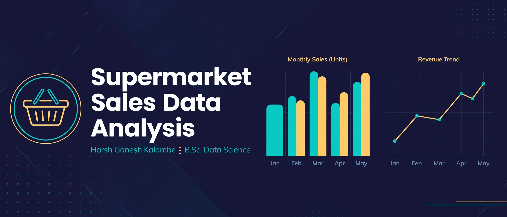
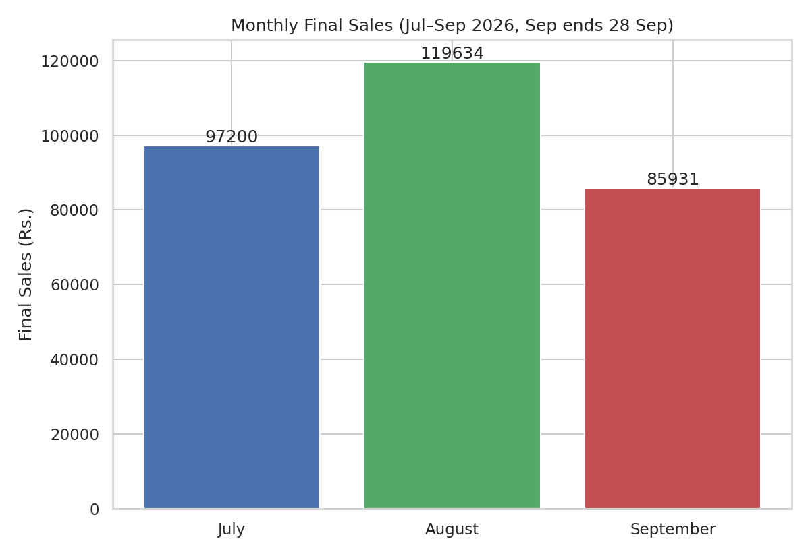
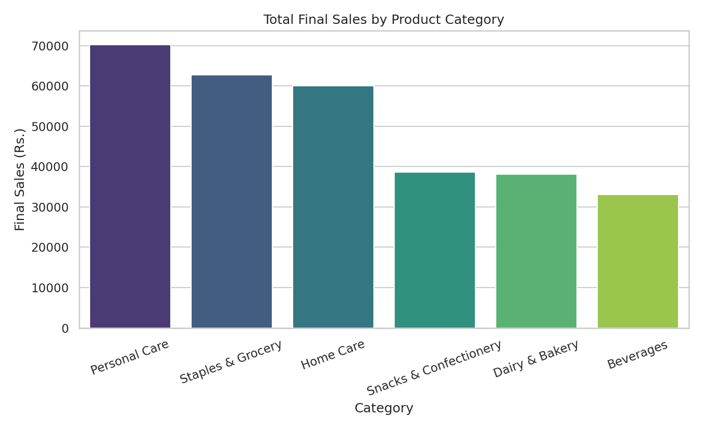
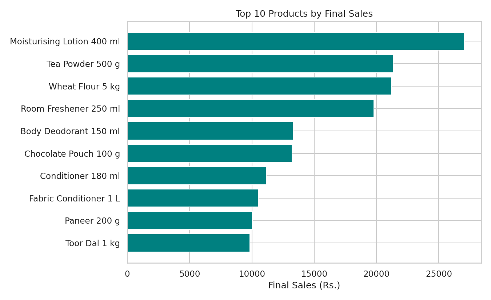
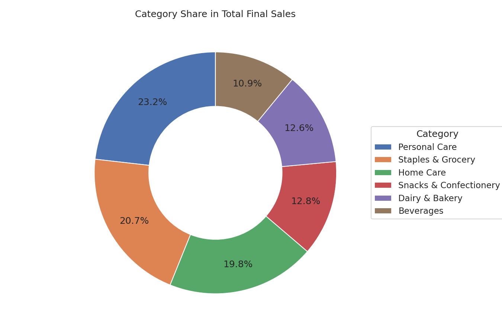
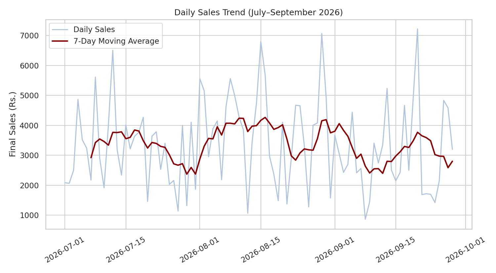

# Supermarket Sales Data Analysis



> **Author:** Harsh Ganesh Kalambe — B.Sc. Data Science
> **Field visit:** Choice Super Market, Virar (East), 29 Sep 2026
> **Data: simulated** — the shop's real billing records were confidential and are not in this project. The sales file was generated in Python (seed 42) for analytical demonstration. No finding here is that shop's real sales.

A complete, reproducible analysis of supermarket sales: audit, cleaning, exploratory analysis, visualisations, business insights and an interactive Streamlit dashboard — every headline number independently re-verified (see `reports/audit-report-task1.md`).

**Live dashboard:** https://supermarket-sales-data-analysis-4kpxcdnngr3ozsfog2waao.streamlit.app/ (deployed on Streamlit Community Cloud, Python 3.12 — see `DEPLOYMENT.md`)
**GitHub repository:** https://github.com/harshkalambe6-crypto/supermarket-sales-data-analysis

## Project overview

This project answers: which categories, products and brands drive sales, when sales rise and fall, how customers pay, and what discounts actually do — using Harsh's field-project dataset (1 Jul – 28 Sep 2026).

## Objectives

- Audit the supplied PDF and notebooks without trusting their calculations.
- Clean the raw file with every dropped/filled row accounted for.
- Summarise sales by category, product, brand, month, payment, customer type and weekday/weekend.
- Visualise the results in publication-ready charts.
- Build a minimal, interactive Streamlit dashboard.
- Present findings honestly: simulated data, stated limitations, no real-world claims.

## Dataset description

| Item | Detail |
|---|---|
| Raw file | `data/supermarket_sales_raw.csv` — 1,215 rows × 14 cols |
| Cleaned file | `data/supermarket_sales_cleaned.csv` — 1,191 rows × 13 cols |
| Period | 1 Jul – 28 Sep 2026 (September ends 28 Sep) |
| Products / Categories / Brands | 42 / 6 / 28 |
| Categories | Staples & Grocery, Beverages, Snacks & Confectionery, Personal Care, Home Care, Dairy & Bakery |
| Columns | Bill_ID, Product_ID, Product_Name, Category, Sub_Category, Brand, Unit_Price, Quantity, Discount_Percent, Date, Payment_Method, Customer_Type, Stock_Available (+ engineered Total_Sales, Discount_Amount, Final_Sales) |
| **Nature of data** | **Simulated (seed 42). Not real transactions.** |

## Tools and technologies

Python · Pandas · NumPy · Matplotlib · Seaborn · Jupyter Notebook · Streamlit

## Data cleaning methodology

Implemented in `src/data_cleaning.py`, exactly as in the original notebook:

1. Discount_Percent missing (30) → fill 0; Payment_Method missing (20) → fill "Not Recorded".
2. Drop 15 exact duplicate rows.
3. Category: strip whitespace + title-case (40 rows with UPPER/lower/spaced variants).
4. Parse Date ("%d-%m-%Y").
5. Remove 9 invalid rows (Quantity ≤ 0: 5; Unit_Price = 0: 4).
6. Drop Record_Source. Result: 1,191 rows, 0 missing values.

Feature engineering: `Total_Sales = Unit_Price × Quantity`; `Discount_Amount = Total_Sales × Discount_Percent / 100`; `Final_Sales = Total_Sales − Discount_Amount`; plus Month, Day_Name, Day_Type, Sales_Category, Quantity_Category.

## Exploratory analysis

`notebooks/supermarket_analysis.ipynb` is Harsh's original 124-cell notebook, adapted only so its file paths work in this repository structure. Run it end to end — it covers loading, cleaning, processing, EDA, summarisation and 19 figures. Originals are preserved in `docs/originals/`.

## Visualizations











Charts are generated by `src/visualization.py` from the cleaned data — actual outputs, not mock-ups.

## Key findings (simulated data only)

- **Final Sales: ₹3,02,764.90** (Total Sales ₹3,17,577.00 − Discount ₹14,812.10) across **1,191 records, 3,160 units**; average ₹254.21 per record.
- **Personal Care leads by value: ₹70,236.10 (23.2%)**, led by Moisturising Lotion 400 ml (₹27,048.00) — yet it sold the fewest units (361).
- **Snacks & Confectionery is the most frequent category (259 records)** but only 4th by value.
- **August was the strongest month: ₹1,19,633.75**; September (₹85,930.85) ends on 28 Sep.
- **UPI leads payments: 581 records, ₹1,56,384.60 (48.8%)**. Bulk Buyers average ₹571.24 per record vs Regular ₹209.05.
- **Discounts barely correlate with Final Sales (r = −0.07)**; top 10 products contribute 52.0% of Final Sales.

Full verified numbers are in `reports/project_summary.md` and `reports/audit-report-task1.md`.

## Business recommendations

1. Protect Personal Care availability — 23.2% of value from 135 records.
2. Keep UPI checkout fast and visible.
3. Serve Bulk Buyers well — small group, largest baskets.
4. Do not judge September as weak — it is a partial month.
5. Test discounts product by product; a blanket discount does not explain sales here.
6. Review slow-value items (Iodised Salt, Full Cream Milk, Cheese Slices) for display/stocking.

## Installation

```bash
git clone https://github.com/harshkalambe6-crypto/supermarket-sales-data-analysis.git
cd supermarket-sales-data-analysis
pip install -r requirements.txt
python src/data_cleaning.py
python src/visualization.py
```

## How to run the dashboard

```bash
streamlit run app.py
```

The dashboard shows Final Sales, records, quantity, product/category/brand performance, monthly trend, interactive filters (date range, product, category, brand, payment, customer type), product comparisons and insights, plus a download of the filtered rows as CSV. It uses the static cleaned file — **not live, not real-time**. With no filter applied it shows Final Sales ₹3,02,764.90 and 1,191 records.

## Project structure

```
supermarket-sales-data-analysis/
├── README.md
├── requirements.txt
├── runtime.txt
├── app.py
├── DEPLOYMENT.md
├── data/
│   ├── supermarket_sales_raw.csv
│   ├── supermarket_sales_cleaned.csv
│   └── data_dictionary.md
├── notebooks/
│   └── supermarket_analysis.ipynb
├── src/
│   ├── data_cleaning.py
│   └── visualization.py
├── visuals/
│   ├── sales_overview.png
│   ├── category_analysis.png
│   ├── product_analysis.png
│   ├── category_share.png
│   ├── payment_analysis.png
│   └── daily_trend.png
├── reports/
│   ├── audit-report-task1.md
│   ├── project_summary.md
│   ├── project_report.md
│   └── interview_defence.md
├── linkedin/
│   ├── carousel-1.png … carousel-6.png
│   ├── linkedin-cover.png
│   ├── linkedin-post.md
│   └── showcase-video.mp4
├── docs/
│   └── originals/   (supplied PDF + both notebooks, unchanged)
└── .gitignore
```

## Limitations

- Simulated data, not the visited shop's real sales.
- No cost prices — profit cannot be analysed.
- No customer IDs — no repeat-purchase analysis.
- Three-month window; September partial; no annual seasonality.
- "Not Recorded" payment (20 records) is a fill-in, not a payment channel.

## Future improvements

- Real, permissioned transaction data.
- Add cost prices for profit analysis, customer IDs for retention.
- Longer time series, demand forecasting, real-time dashboard.
- The Streamlit app is already deployed and linked above; future work is analysis, not deployment.

## License

Academic field project by Harsh Ganesh Kalambe.
